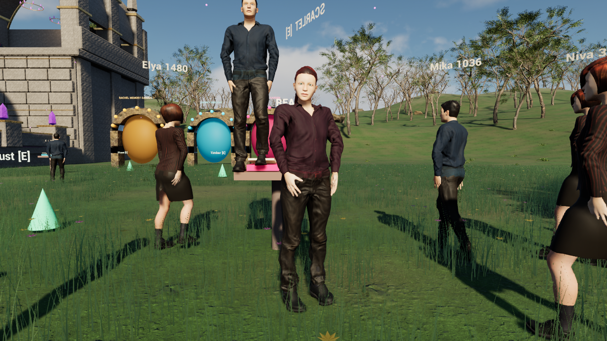

# Entspanntere Bewohnerbewegung

Dieser Kandidat folgt auf den geprüften Wiesenstand `a8bc948`. Er verändert
die gemeinsame Skelettbewegung der drei vorhandenen Figuren und das Verhalten
ihrer Kollisionskörper. Das vorherige Paket bleibt in seiner eigenen Ablage.

[Kurze native Gehsequenz, GIF, etwa 4,6 MB](../Preview/RESIDENT_MOTION.gif)

## Was sich verändert

- Die Handziele erhalten eine entspannte Ellenbogenbeugung von 25 Grad in
  Ruhe und bis zu 45 Grad beim Gestikulieren. Eine kurze gefilterte
  Nachbewegung lässt Hände und seitliche Gewichtsverlagerung nachlaufen.
- Die Fußkurve behält beim Abheben und Aufsetzen ihre Position und
  Geschwindigkeit. Die lokale Rückwärtsbewegung in der Standphase bleibt
  erhalten; bloßes Abbremsen auf lokale Geschwindigkeit null würde den Fuß
  relativ zur laufenden Figur am Boden verschieben.
- Die Animation liest das tatsächliche Bewegungstempo in jedem eigenen
  Update. Sie wartet dafür nicht mehr auf den selteneren Bewohnerzyklus.
- Bewohner und Begleiter sind keine begehbaren Treppen. Neue Bewohner werden
  bei blockiertem Platz ausgelassen, statt durch die Kollisionskorrektur auf
  andere Körper angehoben zu werden. Ihre Bodensuche verwendet statische
  Weltgeometrie.

## Was tatsächlich geprüft ist

Der portable C++-Test prüft 10.000 Gelenkketten und die Übergänge der
Schrittphasen. Er unterscheidet die alte Kurve und ein scheinbar glattes
Gegenmodell, das in Weltkoordinaten am Boden rutscht. Diese analytische
Kontaktprüfung setzt flachen Boden, konstantes Tempo und konstantes
Bewegungsgewicht voraus.

Der native Renderlauf wertet 1.800 Arm- und 1.800 Fußpunkte der drei Begleiter
aus. Alle Idle-Animationen sind geladen. Die gemessene Ellenbogenbeugung
reicht von 25 bis knapp 45 Grad. Die ausgewerteten Knöchel treffen ihre
zuletzt fertig berechneten IK-Ziele innerhalb der ausgegebenen Messpräzision.
Das ist keine globale Messung von Fußrutschen oder menschlicher Natürlichkeit.

Ein eigener nativer Bewohnerlauf enthält 14 körperliche Bewohner, davon
13 mit gemessener Bewegung. Kein untersuchter Bewohner verwendet einen
anderen Pawn als Bewegungsboden. Die Engine verweigert das Hochsteigen;
die im isolierten Test kurz eingeschaltete Gegenprobe erlaubt es wieder und
wird anschließend zurückgesetzt. Flug, geschlossene Tür, Sichtverdeckung,
Warnung, tatsächliche Verfolgung, Festhalten und Freigabe bestehen weiter.

Die [Quellen-, Paket- und Aufnahmequittung](../QA/native-resident-motion.json)
bindet die geänderten Dateien, ausführbaren Dateien, gekochten Pakete,
300 native PNG-Anfragen und die ausgegebenen Medien. Der Aufnahmelauf benutzt
einen festen Simulationsschritt von 30 Hz; daraus entstehen tatsächlich
15 Screenshot-Anfragen pro Simulationssekunde. PNG-Schreiben und die
verfassten Szenenwechsel machen ihn ungeeignet als Leistungsbenchmark.

## Haut und noch offene Gestaltungsarbeit

Ein getrennter Versuch aktivierte die bereits angelegten Subsurface-Eingänge
des Hautmaterials. Die Gesichter wurden dabei zu hell und verloren sichtbare
Konturen. Dieser Versuch wurde nach Bildprüfung verworfen; der endgültige
Materialquelltext entspricht dem Ausgangsstand. Gleiche Aufnahmeeinstellungen
bedeuten dabei keine identische komplette Bewohneranordnung.

Die drei geteilten Modelle, Kleidung und Hautbilder sind weiterhin vorhanden.
Individuellere Gesichter, Hautdetails in Normalen und Rauigkeit, mehr Mimik,
vertikales Nachgeben des Beckens und vollständig simulierte Kleidung sind
eigene offene Schritte. Die aktuelle Änderung ist eine Skelett- und
Kontaktkorrektur, keine Knorpel- oder Weichteilsimulation.

## Start und Rückweg

`Start-Astralis.cmd` startet den Kandidaten aus seinem eigenen Checkout.
Für die neue ausführbare Datei ist ein Neustart des Spielfensters nötig.
Die vorherige Wiesenfassung und die vorangegangenen Desktop-Verknüpfungen
bleiben lokal erhalten. Bestehende MIT-Erlaubnisse sowie die enge
Sechs-Dateien-Zuordnung der Wiesenwerkzeuge bleiben unverändert.
