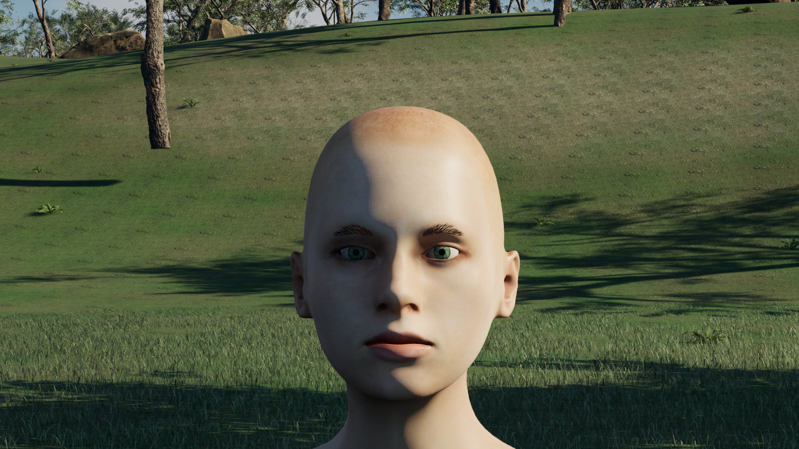
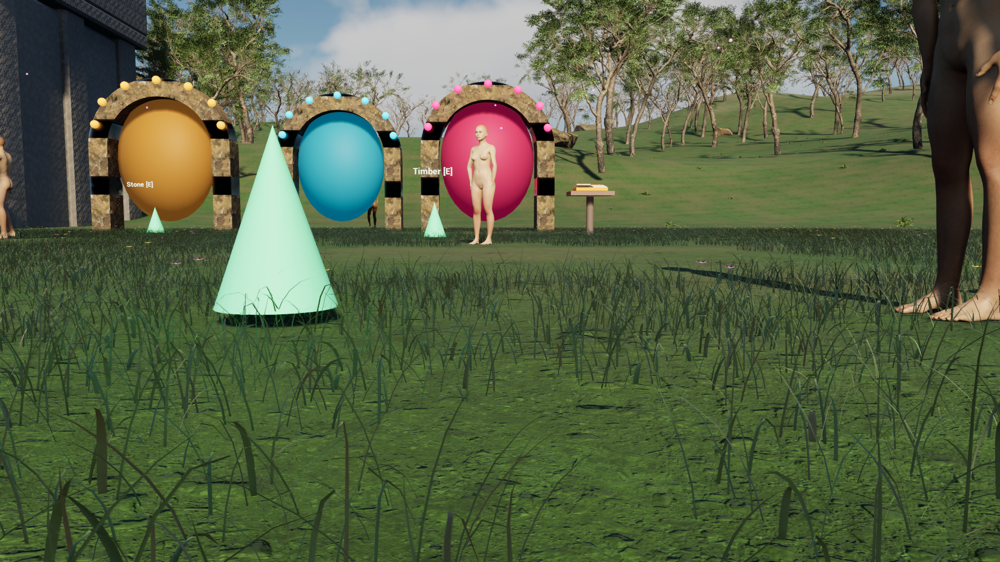

# Sichtbare Figuren und kurze Wiese — Entwicklungskandidat vom 24.10.2026

Die Nutzerabnahme der bisherigen sichtbaren Figurenqualität lautet
`USER_REJECTED_VISUAL_QUALITY`. Die positiven Bewegungs- und Trägertests der
vorherigen Version werden erhalten; sie beantworten diese Qualitätskritik nicht.

## Aktiver Figurenaufbau

Der Generator verwendet acht vollständige erwachsene Körper: Scarlet, Lucinet,
Rachel, Tala, Orin, Ivo, Mara und Neri. Ihre statisch gestalteten Altersangaben
reichen von 25 bis 62 Jahren; die verfeinerten Körperhöhen von etwa 160 bis
188 cm vor zusätzlicher Laufzeitvariation. Das sind Gestaltungsparameter,
keine biologische Simulation und keine Altersbestimmung echter Personen.

Jeder Körper erhält vollständige erwachsene Makroformen, regionale Proportionen
und eigene Gesichtsformen. Eine Catmull–Clark-Unterteilung wird mit demselben
Operator auf Basis und alle Morphs angewendet. Die Oberflächen besitzen etwa
67.000–68.000 Vertices, 163 Quellknochen und acht aktive Morphs. UVs,
Knochengewichte und nicht neutrale Blink-/Sprech-/Atem-/Ausdrucksformen sind
an den exportierten FBX-Dateien geprüft.

Die alte Kleidung, Schuhgeometrie, roten Haarflächen und Körper-Lochmasken
sind aus dem aktiven Export entfernt. Die Körperansicht zeigt vollständige Haut,
bare Füße und einzelne gebogene Brauenhaare. Das ist die ausdrücklich verlangte
Körperüberarbeitung, noch keine neue Garderobe oder fertige Frisurenbibliothek.
Die früheren Quellen bleiben als inaktive Historie erhalten.

Bewohner verwenden alle acht Quellen und einen stabilen Variationssatz für
Kiefer, Nase, Wangen, Brauen, Hautton und Größe. Auch Wachen sind nicht mehr
zwangsläufig derselbe Körper. Die tatsächliche Spielerkamera und die tatsächlichen
Augenpositionen bestimmen beide Blickwinkel; die pauschale Augenhöhe 165 cm ist
entfernt. Atem-, Sprech- und Blinkantworten erreichen auch gewöhnliche Bewohner.

## Haut und Augen

Die Haut verwendet ein eigenes Subsurface-Profil mit aus der Quelltextur
abgeleitetem Albedo-Mittel, begrenzter Streuung, variierender Rauheit und
auflösungsabhängig abgeblendeten Mikronormalen. Die erste stärkere Streuung
verwischte die Gesichtskontur und wurde verworfen. Eine zu starke Poren-Normale
zeigte im Weltlicht sichtbare Noppen; auch sie wurde reduziert. Die Entscheidung
folgt dem tatsächlichen Bild, nicht der Bezeichnung des Shading-Modells.

Iris und Pupille liegen als flache sphärische Kappen am anatomischen Auge,
statt als vorstehende Ellipsoide. Die Iris hat mehrskalige radiale Struktur
und eine reflektierende Deckschicht. Ein gröberer Anteil bleibt sichtbar,
wenn feinere Strukturen wegen ihres Pixelabstands abgeblendet werden.
Haut, Augenweiß, Iris, Pupille und Brauen teilen dasselbe räumliche Bewegungsfeld.
Damit bleibt die Haut nicht als allein verschobene Fläche vor starren Augen stehen.

Das Augenmaterial und die Ausdrucksvielfalt bleiben konkrete Artgrenzen.
Der neue Stand trägt keine Freigabe als fotorealistische oder vollständig
überzeugende menschliche Darstellung. Das Vorliegen eines Profils, eines
Shaders oder eines Tests ersetzt keine Sichtabnahme.

## Wiesenform und Budget

Vier Instanzvarianten enthalten jeweils 256 Halme. 224 davon sind schmalere
Formen mit etwa 0,18–0,55 cm maximaler Breite; 32 sind breitere Bodenblätter
mit etwa 0,60–1,19 cm. Diese Werte gelten vor Instanzskalierung.
Mehr als 90 Prozent der 1.024 Halme liegen bei höchstens 16 cm Höhenparameter;
eine kleinere Gruppe reicht bis 24 cm. Gebogene Spitzen, seitliche Drehung
und verschiedene Wachstumsformen ersetzen die früheren hohen senkrechten Nadeln.

Zwei Randpunkte pro Reihe und eine einzige Spitze ersetzen die harte
Mittelfalte. Schmale Halme verwenden fünf Längssegmente, breitere sechs.
Das ergibt 2.880 Positionen und 2.368 Gras-Dreiecke je Büschel, einschließlich
Blüten höchstens 2.400 Dreiecke. Das Positionsbudget steigt gegenüber dem
vorherigen Schritt nicht; Wurzeldichte steigt und Dreieckszahl sinkt.
Die Grenzen von 3.844 Feldslots und höchstens 96 Bodentraces pro Frame bleiben.
Die Pflanzen sind undurchsichtige Geometrie. Eine vollständige Bodenökologie,
Bodenvolumen, Artenvielfalt oder beliebige Grabtiefe sind damit nicht simuliert.

## Bildbindung und normaler Start

Die abschließende Sichtung umfasst alle acht Weltporträts und fünf Standbilder
der 300 Bilder langen Bewegungsaufnahme. Eine vollständige Filmwiedergabe wurde
nicht durchgeführt. Die großen Guide-Namensschilder sind entfernt; kleine
Interaktionshinweise erscheinen nur in der Nähe des betrachteten Objekts.
Andere große Rohstoffbeschriftungen und die wiederholten Baumquellen bleiben
ein sichtbarer offener Arbeitsast.

`scripts/astral.ps1` nimmt die sichtbaren FBX-Dateien, Hauttexturen und
Charakterinventare in die normale Paketidentität auf. Ein neu erzeugter Körper
kann deshalb nicht bei unverändertem Quellcode als altes gekochtes Paket
versehentlich aktuell bleiben. Die Asset-Vorbereitung archiviert die exakten
generierten Charakterdateien, bevor sie alte Materialslot-Tabellen neu importiert.

`Start-Astralis.cmd` bleibt der normale Einstieg. Die Desktopverknüpfung
`HALVETH Portal Garden` verweist auf denselben Quellstand und Paketweg.
Die ältere Binärdatei und die verworfenen Bildstände bleiben lokal als Rückweg.

[Der gebundene native Prüfstand](../QA/native-visible-appearance.json) enthält
Binär- und Payload-Digests, acht konkrete Weltporträts, zwei weitere Weltbilder,
vier kontrollierte Hautansichten und die Frame-/Zeitbindung der Bewegungsaufnahme.
Die Portraitfixture ersetzt Modelle für die Inspektion und deaktiviert dabei
das Live-Hautfeld. Die Studiofixture hält zusätzlich tatsächliche Augen-/Kopf-
Transformationen, Blick, Blinken, Sprechen und Atempunkt konstant. Sie verwendet
deklariertes weißes Licht und EV12; sie wird nicht als gewöhnliches Weltlicht
ausgegeben. Die getrennte Bewegung zeigt das tatsächliche gemeinsame Feld
und native Gehbewegung ohne Modellwechsel.
Ihre Kameraposition bleibt nach der Aufstellung fest; die Blickrichtung folgt
dem Guide. Der Ausschnitt dreht sich daher und ist keine fest ausgerichtete Kamera.

Der Aufnahmewunsch beträgt 24 Hz. Bei einem festen 30-Hz-Simulationsschritt
ergibt der aktuelle Aufnahmeplan tatsächlich etwa 15 Bilder pro Simulationssekunde.
Der Film wird passend zu diesen Zeitstempeln mit 15 fps kodiert. Weder diese
Kodierung noch ein Offline-Screenshotlauf ist ein normaler Spiel-FPS-Benchmark.

Die weitere sichtbare Arbeit betrifft insbesondere lebendigere Augen und
Ausdruckskorrekturen, anspruchsvollere Bewegungsanimation und eine passende
Garderobe/Frisurenbibliothek. Die begrenzte Welt und ihre wiederverwendeten
Baumquellen sind durch diesen Figurenumbau noch kein fertiges großes Rollenspiel.

## Quellen und Rechte

MakeHuman-Geometrie, Ziel- und Texturdaten sind in den Quellinventaren mit CC0-
Hinweisen gebunden. Die eigenständig geschriebenen Generatoren und Runtime-
Erweiterungen tragen MIT-Hinweise. Die bereits festgelegten sechs Meadow-Dateien
behalten ihre eng zugeordneten PIRL-Regeln und aktualisierten Versionsdigests;
frühere Rechte und Fremdmaterial werden nicht rückwirkend vereinnahmt.

Technischer Referenzpunkt ist die
[Epic-Dokumentation zum Subsurface Profile](https://dev.epicgames.com/documentation/en-us/unreal-engine/subsurface-profile-shading-model-in-unreal-engine).
Ihre Modellbeschreibung ist kein Qualitätsnachweis für unsere konkreten Materialien.
